  <h1>Jose (jose2520)</h1>
  

    Desarrollador apasionado por crear cosas útiles. 👋 ¡Bienvenido a mi perfil!
  

## Sobre mí

- 🔭 Actualmente trabajando en: ...
- 🌱 Actualmente aprendiendo: ...
- 👯 Busco colaborar en: ...
- 💬 Pregúntame sobre: ...
- 📫 Cómo contactarme: ...
- ⚡ Dato curioso: ...

---

## Tech Stack

  

  

  

 

---

## Contacto

  

  

