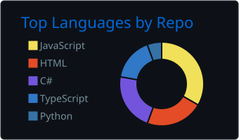
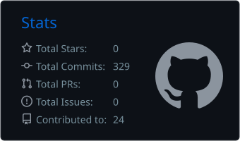

<picture>
  <source media="(prefers-color-scheme: dark)" srcset="./jose-banner.svg" />
  <source media="(prefers-color-scheme: light)" srcset="./jose-banner-light.svg" />
  
</picture>

 

  <a href="https://jose2520.github.io">
    <picture>
      <source media="(prefers-color-scheme: dark)" srcset="./profile-summary-card-output/badge-portfolio.svg" />
      <source media="(prefers-color-scheme: light)" srcset="./profile-summary-card-output/badge-portfolio-light.svg" />
      
    </picture>
  </a>
  <a href="https://www.linkedin.com/in/jose-de-carmen-d">
    <picture>
      <source media="(prefers-color-scheme: dark)" srcset="./profile-summary-card-output/badge-linkedin.svg" />
      <source media="(prefers-color-scheme: light)" srcset="./profile-summary-card-output/badge-linkedin-light.svg" />
      
    </picture>
  </a>
  <a href="mailto:josedelcarmen_diaz@outlook.com">
    <picture>
      <source media="(prefers-color-scheme: dark)" srcset="./profile-summary-card-output/badge-email.svg" />
      <source media="(prefers-color-scheme: light)" srcset="./profile-summary-card-output/badge-email-light.svg" />
      
    </picture>
  </a>

## Sobre mí

¡Hola! Soy **Jose Del Carmen Díaz Díaz**, Tecnólogo en Análisis y Desarrollo de Software del **SENA** y actualmente fortalezco mi perfil como desarrollador Full-Stack en **RIWI**. Me apasiona crear soluciones tecnológicas —aplicaciones web y móviles— integrando **Frontend, Backend y diseño UX/UI**, sumando mi base en ilustración y diseño gráfico para llevar cada idea desde el prototipo en Figma hasta producción.

Me caracterizo por el aprendizaje continuo, la resolución de problemas y la adaptación a nuevos retos. Busco una oportunidad donde aportar mis conocimientos y seguir creciendo en el sector tecnológico.

- **Formación:** Tecnólogo en Análisis y Desarrollo de Software (**SENA**, grado 2026), desarrollo Full-Stack en **RIWI** (en curso) y certificado profesional **Google UX Design**. Cursos de análisis de datos (**MinTIC** y **BeTek**), Scrum (**SENA**), ilustración artística (**EDA**) y diseño gráfico (**SENA**).
- **Enfoque:** web y mobile con `React`, `Next.js`, `React Native` y `TypeScript`; backend y APIs REST con `C# .NET`, `Node.js`, `Python` y `Laravel`; datos con `PostgreSQL`, `MySQL`, `MongoDB` y `Pandas`; diseño con `Figma` y despliegue con `Docker` y `Azure`.
- **Disponibilidad e idiomas:** abierto a oportunidades **presenciales, híbridas y remotas** (Barranquilla, Colombia) · Español (nativo) e inglés (A2).

## Experiencia destacada

**Programador · Colegio Real Royal School** Barranquilla · ago 2025 – ene 2026

Desarrollé el ecosistema digital de la institución, desde el prototipado en Figma hasta producción.

| Producto | Qué resuelve | Stack |
| :-- | :-- | :-- |
| Plataforma web | Difusión del campeonato: gestión de jugadores, puntajes y contenido multimedia | `PHP` · `MySQL` · `Bootstrap` |
| App móvil administrativa | Gestión académica y operativa del colegio | `React Native` · `Expo` |
| Diseño de producto | Prototipos y UI de ambas soluciones | `Figma` |

## Proyectos destacados

<table>
  <tr>
    <td width="50%" valign="top">
      <b>Firmeza</b> · <a href="https://github.com/jose2520/Firmeza-jd">API</a> · <a href="https://github.com/jose2520/Firmeza_frontn">Web</a> · <a href="https://github.com/jose2520/Firmeza_frontend">Mobile</a>
       
      Ecosistema comercial, logística de despachos a obra y alquiler de maquinaria pesada con Clean Architecture, facturación PDF, JWT y 112 tests.
        
      <code>C# .NET 10</code> · <code>PostgreSQL</code> · <code>React</code> · <code>React Native</code> · <code>Expo</code> · <code>TypeScript</code>
    </td>
    <td width="50%" valign="top">
      <b>SkillHub</b> · <a href="https://github.com/jose2520/SkillHub_back">API</a> · <a href="https://github.com/jose2520/SkillHub_front">Web</a>
       
      Plataforma de talleres e inscripciones con cupos en tiempo real, calendario interactivo, certificados PDF con marca de agua, importación Excel y 88 tests.
        
      <code>C# .NET 10</code> · <code>PostgreSQL</code> · <code>Docker</code> · <code>React</code> · <code>Tailwind CSS</code>
    </td>
  </tr>
  <tr>
    <td width="50%" valign="top">
      <b><a href="https://github.com/MeliRodriguezB/Riwi_Connect">Riwi Connect</a></b> · Full-Stack &amp; IA
       
      Conformación inteligente de equipos de trabajo mediante evaluación técnica, perfilamiento profesional con IA y recomendación por habilidades complementarias.
        
      <code>Python</code> · <code>Flask</code> · <code>PostgreSQL</code> · <code>JavaScript</code> · <code>Vite</code> · <code>Docker</code> · <code>Gemini API</code>
    </td>
    <td width="50%" valign="top">
      <b><a href="https://github.com/jose2520/Comercializadora-Agr-cola-El-Roble">Comercializadora El Roble</a></b> · Backend
       
      Sistema de recepción en báscula, liquidación a productores agrícolas, conversión TRM en vivo (API Datos Abiertos Colombia) y 6 reportes gerenciales.
        
      <code>C# .NET 10</code> · <code>LINQ</code> · <code>Clean Architecture</code> · <code>REST API</code>
    </td>
  </tr>
  <tr>
    <td width="50%" valign="top">
      <b><a href="https://github.com/jose2520/CF-el-progreso">Cooperativa El Progreso</a></b> · Backend
       
      Sistema transaccional de taquilla bancaria en arquitectura N-Capas con gestión de asociados, depósitos/retiros auditados, consulta TRM y reportes.
        
      <code>C# .NET 10</code> · <code>LINQ</code> · <code>N-Tier Architecture</code>
    </td>
    <td width="50%" valign="top">
      <b><a href="https://github.com/jose2520/tiendalucho">Lucho Díaz Shop</a></b> · Frontend
       
      E-commerce modular con carrito persistente, filtros dinámicos en tiempo real, animaciones Canvas, accesibilidad WCAG 2.1 y checkout vía WhatsApp.
        
      <code>JavaScript</code> · <code>HTML5</code> · <code>CSS3</code> · <code>Canvas</code>
    </td>
  </tr>
</table>

## Stack tecnológico

#### Frontend y mobile

 React también para mobile con React Native y Expo.

#### Backend y bases de datos

#### Diseño, datos y entorno

 Análisis de datos con Python: Pandas, NumPy, Matplotlib, Seaborn y Jupyter Notebook. Metodología ágil Scrum.

## Actividad en GitHub

  <picture>
    <source media="(prefers-color-scheme: dark)" srcset="./profile-summary-card-output/streak-stats.svg" />
    <source media="(prefers-color-scheme: light)" srcset="./profile-summary-card-output/streak-stats-light.svg" />
    
  </picture>

  <picture>
    <source media="(prefers-color-scheme: dark)" srcset="./profile-summary-card-output/github_dark/0-profile-details.svg" />
    <source media="(prefers-color-scheme: light)" srcset="./profile-summary-card-output/default/0-profile-details.svg" />
    
  </picture>

  <picture>
    <source media="(prefers-color-scheme: dark)" srcset="./profile-summary-card-output/github_dark/2-most-commit-language.svg" />
    <source media="(prefers-color-scheme: light)" srcset="./profile-summary-card-output/default/2-most-commit-language.svg" />
    
  </picture>
  <picture>
    <source media="(prefers-color-scheme: dark)" srcset="./profile-summary-card-output/github_dark/1-repos-per-language.svg" />
    <source media="(prefers-color-scheme: light)" srcset="./profile-summary-card-output/default/1-repos-per-language.svg" />
    
  </picture>

  <picture>
    <source media="(prefers-color-scheme: dark)" srcset="./profile-summary-card-output/github_dark/3-stats.svg" />
    <source media="(prefers-color-scheme: light)" srcset="./profile-summary-card-output/default/3-stats.svg" />
    
  </picture>
  <picture>
    <source media="(prefers-color-scheme: dark)" srcset="./profile-summary-card-output/github_dark/4-productive-time.svg" />
    <source media="(prefers-color-scheme: light)" srcset="./profile-summary-card-output/default/4-productive-time.svg" />
    
  </picture>

 

<picture>
  <source media="(prefers-color-scheme: dark)" srcset="./jose-footer.svg" />
  <source media="(prefers-color-scheme: light)" srcset="./jose-footer-light.svg" />
  
</picture>
