<picture>
  <source media="(prefers-color-scheme: dark)" srcset="./jose-banner.svg" />
  <source media="(prefers-color-scheme: light)" srcset="./jose-banner-light.svg" />
  
</picture>

 

  <a href="https://jose2520.github.io">
    <picture>
      <source media="(prefers-color-scheme: dark)" srcset="./profile-summary-card-output/badge-portfolio.svg" />
      <source media="(prefers-color-scheme: light)" srcset="./profile-summary-card-output/badge-portfolio-light.svg" />
      
    </picture>
  </a>
  <a href="https://www.linkedin.com/in/jose-de-carmen-d">
    <picture>
      <source media="(prefers-color-scheme: dark)" srcset="./profile-summary-card-output/badge-linkedin.svg" />
      <source media="(prefers-color-scheme: light)" srcset="./profile-summary-card-output/badge-linkedin-light.svg" />
      
    </picture>
  </a>
  <a href="mailto:josedelcarmen_diaz@outlook.com">
    <picture>
      <source media="(prefers-color-scheme: dark)" srcset="./profile-summary-card-output/badge-email.svg" />
      <source media="(prefers-color-scheme: light)" srcset="./profile-summary-card-output/badge-email-light.svg" />
      
    </picture>
  </a>

## Sobre mí

Construyo productos web y móviles donde la arquitectura técnica y el diseño visual trabajan juntos. Vengo de la ilustración y el diseño gráfico, y hoy llevo esa mirada al código: del boceto en Figma a la app en producción.

- **Formación:** Tecnólogo en Análisis y Desarrollo de Software (**SENA**), desarrollador Full-Stack en **RIWI** y certificado en **Google UX Design**. Base artística e ilustración (**EDA**) y diseño gráfico (**SENA**).
- **Enfoque:** web y mobile con `React`, `Next.js`, `React Native` y `TypeScript`; APIs con `.NET`, `Node.js`, `Python` y `Laravel`; datos con `PostgreSQL`, `MongoDB` y `Pandas`.

## Proyecto destacado

**Colegio Real Royal School.** Lideré su ecosistema digital completo, desde el prototipado en Figma hasta producción.

| Producto | Stack |
| :-- | :-- |
| Plataforma web | `PHP` · `MySQL` · `Bootstrap` |
| App móvil administrativa | `React Native` · `Expo` |
| Diseño de producto | `Figma` (prototipos y UI) |

## Tech stack

#### Frontend y mobile

 React también para mobile con React Native y Expo.

#### Backend y bases de datos

#### Diseño, datos y entorno

 Análisis de datos con Python y Pandas.

## Actividad en GitHub

  <picture>
    <source media="(prefers-color-scheme: dark)" srcset="./profile-summary-card-output/streak-stats.svg" />
    <source media="(prefers-color-scheme: light)" srcset="./profile-summary-card-output/streak-stats-light.svg" />
    
  </picture>

  <picture>
    <source media="(prefers-color-scheme: dark)" srcset="./profile-summary-card-output/github_dark/2-most-commit-language.svg" />
    <source media="(prefers-color-scheme: light)" srcset="./profile-summary-card-output/default/2-most-commit-language.svg" />
    
  </picture>
  <picture>
    <source media="(prefers-color-scheme: dark)" srcset="./profile-summary-card-output/github_dark/4-productive-time.svg" />
    <source media="(prefers-color-scheme: light)" srcset="./profile-summary-card-output/default/4-productive-time.svg" />
    
  </picture>

 

<picture>
  <source media="(prefers-color-scheme: dark)" srcset="./jose-footer.svg" />
  <source media="(prefers-color-scheme: light)" srcset="./jose-footer-light.svg" />
  
</picture>
